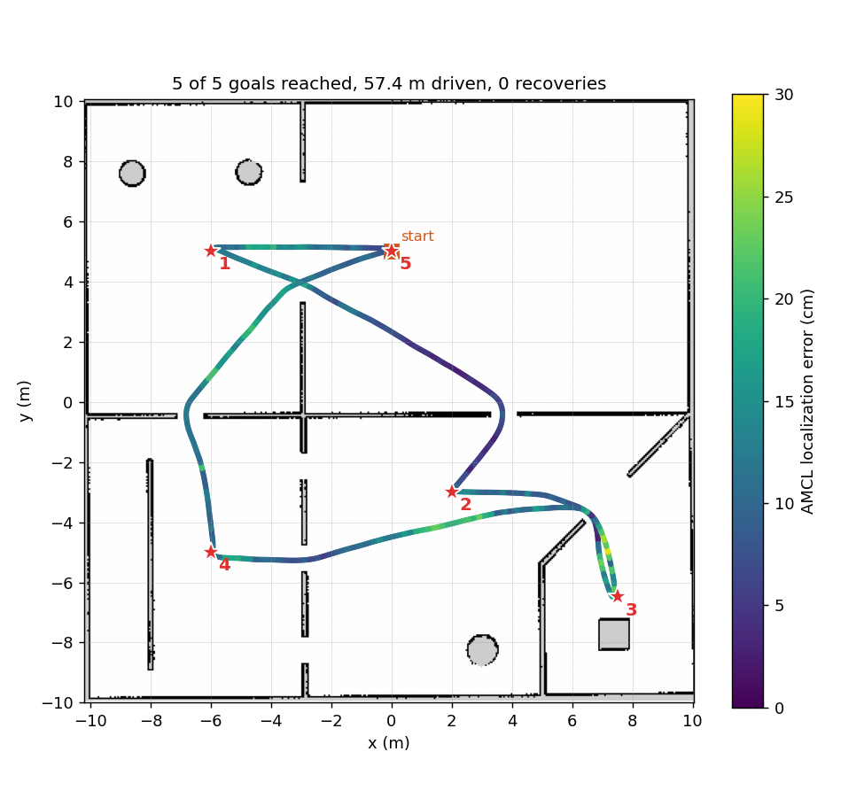
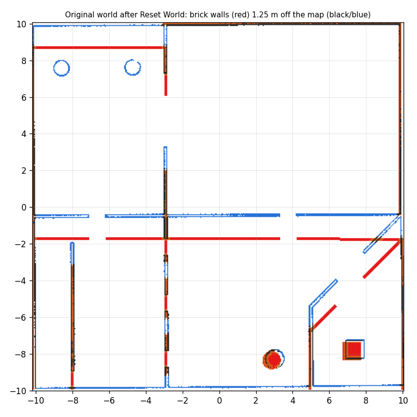

# testbed_navigation

Autonomous navigation for the Testbed-T1.0.0 robot, built by launching each Nav2 server directly instead of using `nav2_bringup`.

**Result:** on a five-goal tour of the testbed world, the robot reached **5 of 5 goals**, driving 57.4 m with **0 recoveries**. Every goal finished within 16.4 cm of its target, and AMCL's localization error stayed under 29 cm the whole way.



## How to run

```bash
cd ~/assignment_ws
colcon build --symlink-install
source install/setup.bash

# Everything in one command: Gazebo, robot, RViz, map, AMCL, Nav2
ros2 launch testbed_navigation testbed_navigation.launch.py
```

In RViz, click **Nav2 Goal** and then a point on the map; the robot plans a path and drives there. Use **2D Pose Estimate** if you move the robot by hand.

Each layer can also be started on its own, on top of a running simulation (`ros2 launch testbed_bringup testbed_full_bringup.launch.py`):

| Layer | Command | What it starts |
|---|---|---|
| Map | `ros2 launch testbed_navigation map_loader.launch.py` | `map_server` + `lifecycle_manager_map` |
| Localization | `ros2 launch testbed_navigation localization.launch.py` | `amcl` + `lifecycle_manager_localization` (also starts the map loader unless `load_map:=false`) |
| Navigation | `ros2 launch testbed_navigation navigation.launch.py` | `controller_server`, `planner_server`, `behavior_server`, `bt_navigator`, `velocity_smoother` + `lifecycle_manager_navigation` |

Launch arguments: `map:=<yaml>` (map loader, localization, top level), `params_file:=<yaml>` (localization, navigation), `use_sim_time`, `autostart`, and `sim:=false` on the top-level file to skip starting the simulation.

## Package layout

```
testbed_navigation/
├── launch/
│   ├── map_loader.launch.py         map_server
│   ├── localization.launch.py       AMCL (+ map loader)
│   ├── navigation.launch.py         the Nav2 navigation servers
│   └── testbed_navigation.launch.py everything, including the simulation
├── config/
│   ├── amcl_params.yaml             localization parameters
│   └── nav2_params.yaml             costmaps, planner, controller, BT, behaviours, smoother
├── rviz/navigation.rviz             map, costmaps, particles, plan, footprint, goal tools
├── scripts/                         test tools (ros2 run testbed_navigation <name>)
└── media/                           result images and the recorded tour
```

## Approach

I built the stack in layers and tested each one in simulation before adding the next, so a failure always pointed at the newest layer.

### How the pieces connect

```
/scan ─┬─────────────► amcl ──► TF map→odom
       │                ▲
/map ──┼── map_server ──┘
       │
       ├─► global_costmap (static + obstacle + inflation) ─► planner_server (NavFn) ─┐
       └─► local_costmap  (obstacle + inflation)        ─► controller_server (RPP) ─┤
                                                                                     │
  Nav2 Goal ─► bt_navigator ── behaviour tree: plan → follow → recover ◄────────────┘
                                  │
                       behavior_server (spin, back up, wait)

controller_server ─► /cmd_vel_nav ─► velocity_smoother ─► /cmd_vel ─► Gazebo diff drive
```

TF tree: `map → odom` (AMCL) `→ base_footprint` (Gazebo diff-drive plugin) `→ base_link → lidar_link_1` (robot_state_publisher).

**Lifecycle nodes.** Every Nav2 server starts *unconfigured* and does nothing until it is configured and activated. `nav2_bringup` normally does this; here each launch file runs its own `nav2_lifecycle_manager` with `autostart: true` and the list of nodes it owns.

### Map loading
`map_server` serves `testbed_bringup/maps/testbed_world.yaml` (405 × 400 cells at 0.05 m, about 20 m × 20 m). The map frame coincides with the Gazebo world frame, which made it possible to measure localization error exactly (see *Testing*).

### Localization (AMCL)
| Parameter | Value | Why |
|---|---|---|
| `robot_model_type` | `DifferentialMotionModel` | Two-wheel differential drive |
| `base_frame_id` | `base_footprint` | The frame odometry reports, now at the wheel-axle midpoint |
| `initial_pose` | (0, 5, yaw 0) | Where `spawn_testbed.launch.py` places the robot |
| `laser_max_range` | 12.0 m | Matches the (fixed) lidar range |
| `alpha1`–`alpha5` | 0.1 | Gazebo odometry is clean, so less odometry noise than the 0.2 default |
| particles | 500–2000 | Nav2 default range |

### Navigation plugins
| Server | Plugin | Why this one |
|---|---|---|
| Planner | `nav2_navfn_planner/NavfnPlanner`, Dijkstra | Simple and reliable on a static grid map. A* was tried first and failed on long routes (see *Challenges*). |
| Controller | `RegulatedPurePursuitController` | Follows the path smoothly for a differential drive; few parameters to tune. Slows on tight curves, near obstacles and near the goal; turns in place when the path is more than 45° off. |
| Behaviour tree | Nav2 default `navigate_to_pose_w_replanning_and_recovery.xml` | Replans at 1 Hz; on failure clears costmaps, then spins, waits or backs up |
| Behaviours | `Spin`, `BackUp`, `Wait` | Exactly the recoveries the default tree calls |
| Velocity smoother | `nav2_velocity_smoother` | Caps speed (0.3 m/s, 1.0 rad/s) and acceleration before commands reach the robot |

**Footprint.** Measured from the robot's meshes, the robot is 0.35 m × 0.41 m and symmetric about `base_footprint`. The costmaps use that rectangle plus 2 cm of padding on each side, `[[0.195, 0.225], [0.195, -0.225], [-0.195, -0.225], [-0.195, 0.225]]`, with a 0.45 m inflation radius.

## Testing

In this simulation, `/odom` comes from the Gazebo diff-drive plugin's default *world* odometry source. It is the true pose, which I confirmed against Gazebo's own model pose. Because the map frame equals the world frame, AMCL's `map → odom` transform **is** its localization error. Three tools in `scripts/` use that:

| Tool | What it measures |
|---|---|
| `drive_test.py` | Commands fixed motions and compares them with the real motion: wheel slip, turning rate, rotation centre |
| `localization_test.py` | Drives a fixed route of spins and straights and prints AMCL's error after each step |
| `navigation_test.py` | Sends `NavigateToPose` goals and reports result, time, distance, recoveries, final error and worst localization error; can save the path to CSV |
| `plot_route.py` | Draws a saved path on the map, coloured by localization error |

Final tour (`media/navigation_tour.txt`):

| Goal (x, y) | Result | Time | Driven | Recoveries | Final error | Worst AMCL error |
|---|---|---|---|---|---|---|
| (−6.0, 5.0) | SUCCEEDED | 31.9 s | 5.96 m | 0 | 0.088 m | 0.196 m |
| (2.0, −3.0) | SUCCEEDED | 56.5 s | 14.37 m | 0 | 0.022 m | 0.179 m |
| (7.5, −6.5) | SUCCEEDED | 28.5 s | 7.59 m | 0 | 0.157 m | 0.233 m |
| (−6.0, −5.0) | SUCCEEDED | 60.5 s | 15.80 m | 0 | 0.084 m | 0.287 m |
| (0.0, 5.0) | SUCCEEDED | 50.0 s | 13.71 m | 0 | 0.164 m | 0.213 m |

The route covers the left room through the wide doorway, the lower rooms through the 0.9 m gaps, and the enclosed corner. Final errors include the 0.15 m goal tolerance.

## Challenges

The full log, with root causes and evidence, is in [`BUGS_FIXED.md`](../BUGS_FIXED.md) at the repo root. The ones that shaped this package:

1. **Localization broke on every spin** (bug #12). `base_footprint` sat 6 cm from the wheel-axle midpoint, so turning in place looked to AMCL like moving sideways, which a differential-drive model treats as heavy noise. AMCL error reached 0.51 m after one 360° spin. Moving `base_footprint` to the axle midpoint brought the error down to 2–7 cm.
2. **The walls moved on Reset World** (bug #13). The world file gave the brick-wall model two different poses; a reset put every wall 1.25 m from where the map has it, and AMCL followed the walls. AMCL itself was working; finding that out took logging error along the path, scoring the scan against the map at both poses, and reading the walls' live pose from Gazebo.

   

3. **Planner failures with A\*.** NavFn's A* mode failed 7 times on one long route ("Failed to create a plan from potential when a legal potential was found"), costing 8 recoveries. Dijkstra fixed it with no measurable slowdown on this map.
4. **Launch arguments leak between included files.** In the top-level launch file, `localization.launch.py`'s `params_file` (the AMCL file) was silently reused by `navigation.launch.py`, so the navigation servers ran on built-in defaults. Each include is now wrapped in a scoped `GroupAction`.
5. **`lifecycle_manager` can't start on this machine.** It exits with `libdiagnostic_updater.so: cannot open shared object file`, because Nav2 1.1.20 needs `ros-humble-diagnostic-updater` 4.0.7 and 4.0.6 is installed. The same library is needed by Nav2's RViz particle display. Fix: `sudo apt install --only-upgrade ros-humble-diagnostic-updater`. Until then, each node can be started by hand with `ros2 lifecycle set <node> configure` and then `activate`. To confirm the diagnosis, the 4.0.7 library was also loaded for a single test run without changing the system: all three lifecycle managers then activated every node on their own, and the tour again reached 5 of 5 goals with 0 recoveries.
